<p align="center">
  
</p>

<h1 align="center">pilotfish</h1>

[](https://github.com/anyhowfeel/pilotfish/actions/workflows/ci.yml)
[](LICENSE)
[](https://www.rust-lang.org)


A small desktop packet viewer written in Rust with [egui](https://github.com/emilk/egui).
Capture files open without Wireshark: a built-in reader and decoder feed the Overview, Hosts, Map,
Packets, Graphs and Properties pages. Deep dissection (HTTP and TLS details, streams, objects,
Decode As, exports) and live capture go through `tshark` / `dumpcap` (Wireshark's command-line
tools), which pilotfish starts only when a request needs them.

This is a prototype built to explore what a Wireshark front end could look like. It is not
meant to replace Wireshark or Sniffnet, and it covers only a small part of what they do.

## Screenshots

Taken on a small synthetic capture: a laptop, a TV, a phone and a NAS on an invented home network,
talking to well-known public services over DNS, TLS, plain HTTP and SMB-style transfers, with a
retransmission burst and three made-up behaviours for Insights (a visitor scanning the NAS, a phone
calling a documentation address at a steady rhythm, and very long DNS names). Nothing in it comes from a
real network. `tests/fixtures/gen_demo_capture.py` writes it, so you can open the same file and compare:
`pilotfish tests/fixtures/demo.pcap`.

The last row comes from other invented captures: Diff compares two cuts of the same demo capture (one without
the scan and `mail.proton.me`, the other without `github.com` and the TV), Streams opens
`tests/fixtures/web-streams.pcap` and Credentials `tests/fixtures/credentials.pcap`, whose logins and passwords
are made up and shown masked.

| Overview | Packets | Hosts |
| :---: | :---: | :---: |
|  | 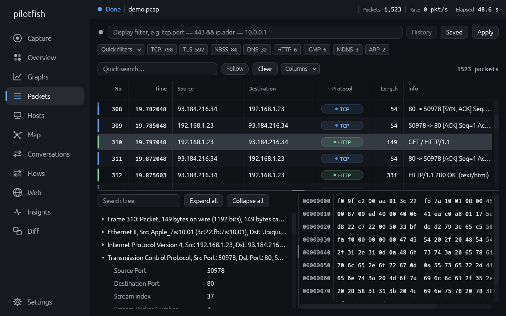 | 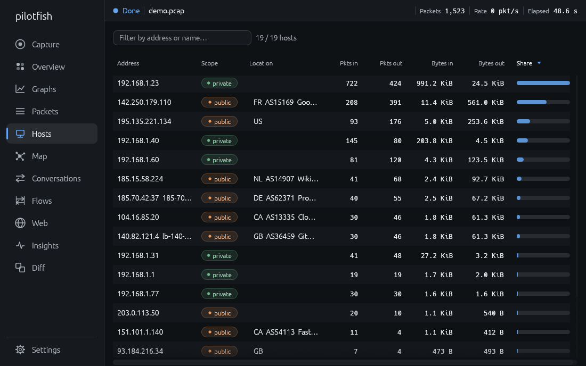 |

| Map | Web | Insights |
| :---: | :---: | :---: |
|  | 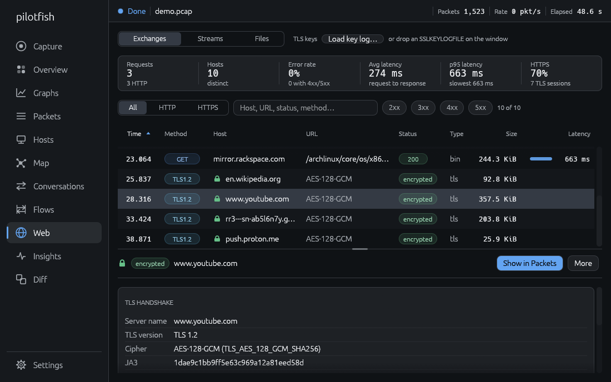 | 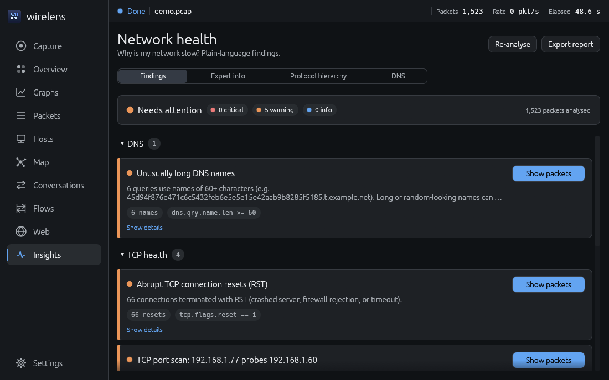 |

| Flows | Graphs | Settings |
| :---: | :---: | :---: |
| 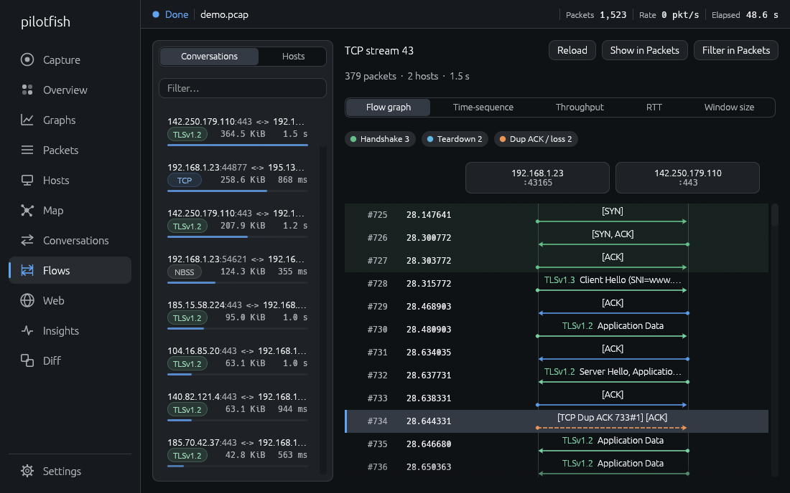 |  | 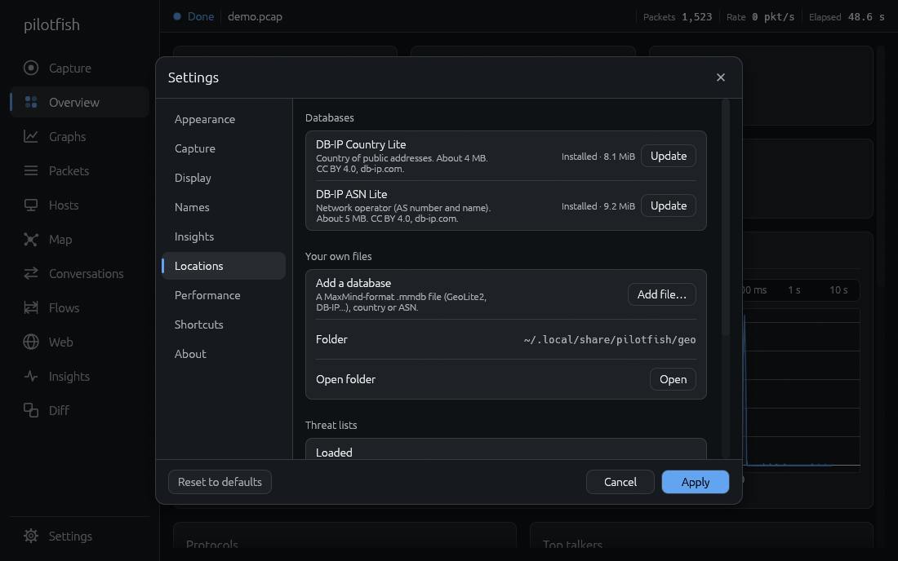 |

| Diff | Streams | Credentials |
| :---: | :---: | :---: |
| 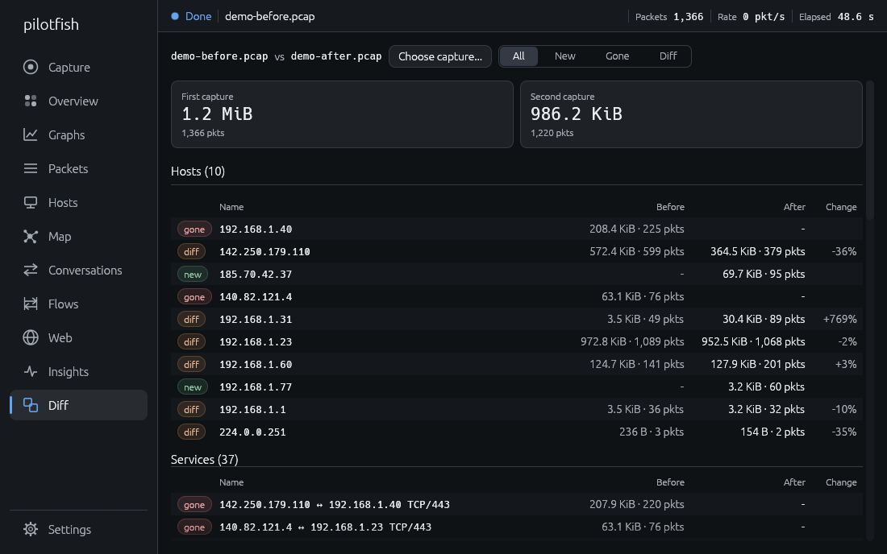 | 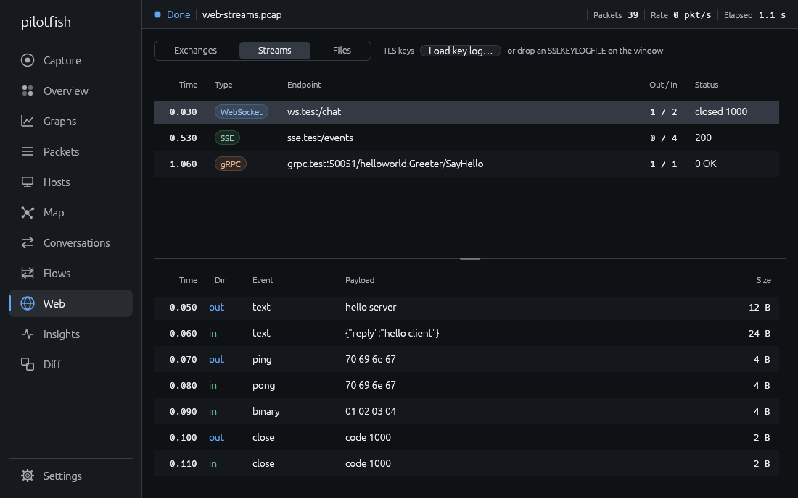 | 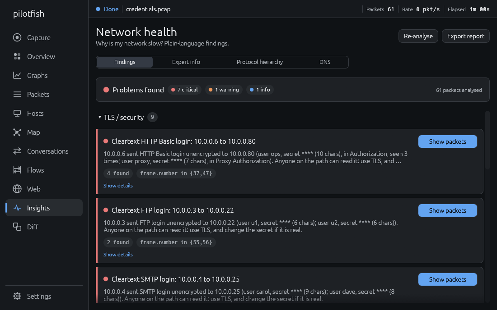 |

<details>
<summary>Light theme</summary>

| Overview | Packets | Hosts |
| :---: | :---: | :---: |
|  |  |  |

| Map | Web | Insights |
| :---: | :---: | :---: |
| 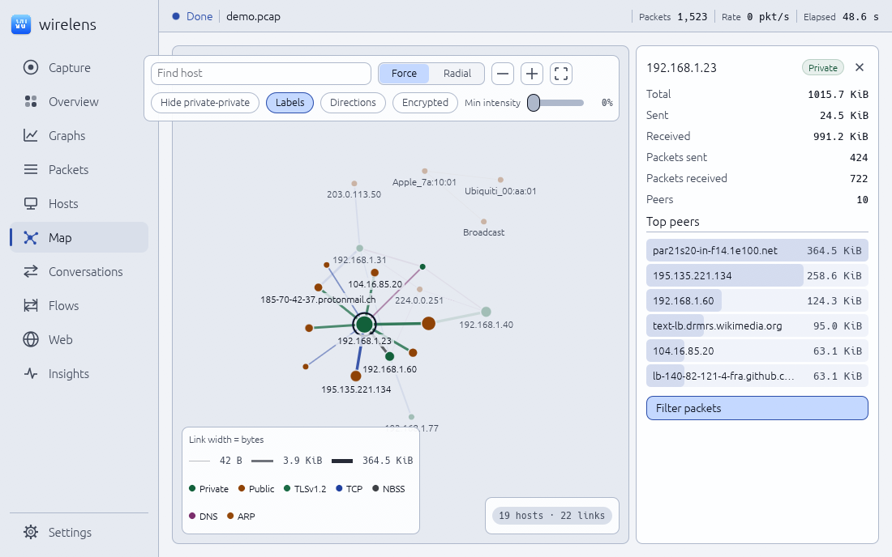 |  |  |

| Flows | Graphs | Settings |
| :---: | :---: | :---: |
|  | 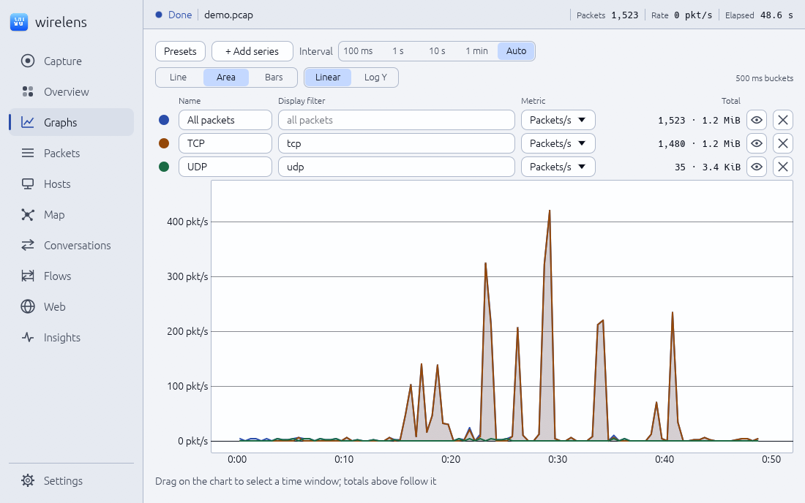 |  |

| Diff | Streams | Credentials |
| :---: | :---: | :---: |
| 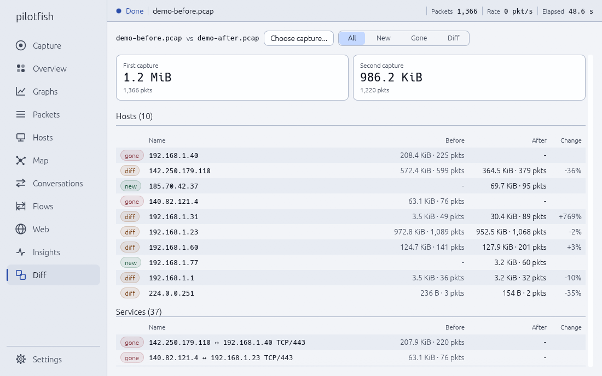 | 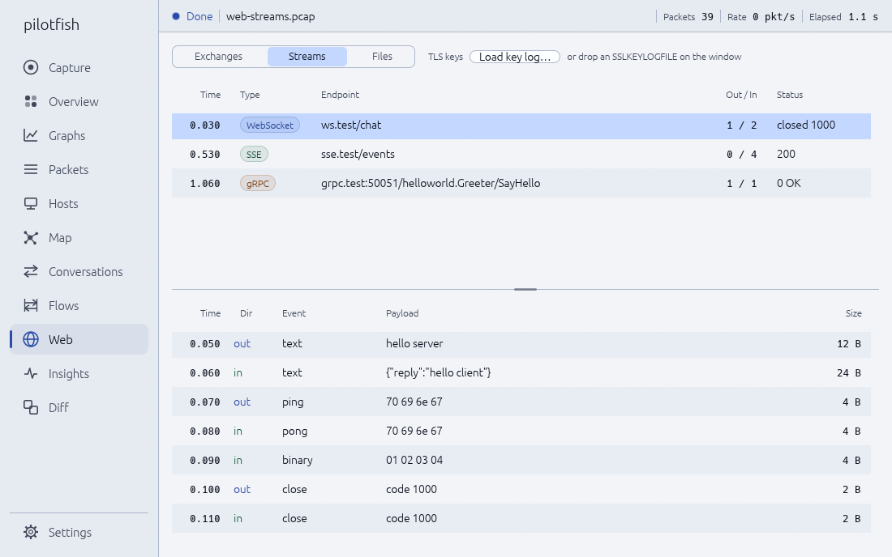 | 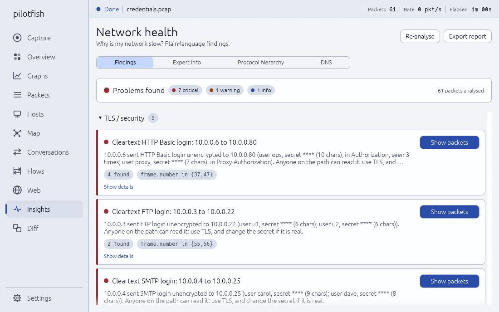 |

</details>

## Install

Each [release](https://github.com/anyhowfeel/pilotfish/releases) contains, next to a `SHA256SUMS` file:

| Platform | File | Notes |
| --- | --- | --- |
| Debian, Ubuntu | `pilotfish_<version>_amd64.deb` / `_arm64.deb` | `sudo apt install ./pilotfish_*.deb` also installs the recommended `tshark`. |
| Arch Linux | `pilotfish-<version>-1-x86_64.pkg.tar.zst`, or `packaging/arch/PKGBUILD` | `sudo pacman -U pilotfish-*.pkg.tar.zst` (the package is not signed), or `cd packaging/arch && makepkg -si` to build it from the tagged source. |
| Other Linux | `pilotfish-<tag>-linux-x86_64.tar.gz`, `-linux-aarch64.tar.gz` | Unpack and run `./pilotfish`. |
| Windows | `pilotfish-<version>-windows-x86_64-setup.exe` | Installer; a `.zip` with the bare executable is also provided. |
| macOS | `pilotfish-<version>-macos-arm64.dmg`, `-macos-x86_64.dmg` | Drag `pilotfish` to `Applications`. The app is not signed: on first launch use right-click, Open. |

Wireshark's command-line tools (`tshark`, `dumpcap`) must be installed separately on Windows and
macOS. The Linux and Windows files are built in containers (see [docs/releasing.md](docs/releasing.md)) and
the macOS images, the Windows installer and the Linux arm64 files by a workflow when a release is published. They have not been tested on every platform. On
macOS, pilotfish also looks for the tools in the Wireshark app and in the Homebrew folders, so it finds them
when started from the Finder.

## Requirements

- A recent stable Rust toolchain (edition 2024).
- Wireshark's command-line tools on `PATH` for everything beyond reading a file: `tshark`,
  `dumpcap`, and optionally `editcap`, `mergecap` and `capinfos` (live capture, packet dissection,
  export and large selections use them). Without them a capture file still opens and the pages
  listed above work; a feature that needs Wireshark says so.
- For live capture, permission to capture without root (on Linux, being in the `wireshark`
  group is usually enough).

### macOS and Windows

An app started from Finder, the Dock or the Start menu does not see the shell's `PATH`, so pilotfish also
looks where the installers put the tools: `Wireshark.app/Contents/MacOS` (in `/Applications` or `~/Applications`),
the Homebrew and MacPorts folders and the login shell's `PATH` on macOS, and `Program Files\Wireshark` on Windows.
If Wireshark is elsewhere, set Settings > Capture > Wireshark folder or `PILOTFISH_WIRESHARK_DIR`, then restart.
Live capture on macOS needs access to `/dev/bpf*`: run "Install ChmodBPF.pkg" from the Wireshark disk image,
check that your user is in the `access_bpf` group, then log out and back in.

Developed and tested on Linux only (Wayland and X11).

## Build and run

```sh
cargo run --release -- capture.pcapng      # open a file
cargo run --release -- --live eth0         # capture live on an interface
cargo run --release                        # start on the Capture page
```

The binary is called `pilotfish`.

## Command line

```
pilotfish [OPTIONS] [FILE]
```

| Option | Description |
| --- | --- |
| `FILE` | Capture file (`.pcap`, `.pcapng`, `.pcap.gz`) to open. |
| `--live <IFACE>` | Start a live capture on this interface. |
| `--filter <EXPR>` | Display filter applied to the opened file, as if typed in the filter bar. |
| `--page <NAME>` | Page to open: `capture`, `overview`, `graphs`, `packets`, `hosts`, `map`, `conversations`, `flows`, `web`, `insights`. |
| `--detach <PAGE>` | Open a page in its own window (repeatable). |
| `--decode-as <RULE>` | Decode-as rule applied at startup, e.g. `tcp.port==8080,http` (repeatable). |
| `--scale <F>` | UI scale factor, e.g. `1.25`. |
| `--size <WxH>` | Initial window size, e.g. `1440x900`. |
| `--light` | Start in the light theme. |
| `-h`, `--help` / `-V`, `--version` | Help and version. |

A few hidden options exist for development (`--screenshot`, `--bench-frames`, `--demo-map`,
...); they are not part of the supported interface.

Environment variables:

| Variable | Description |
| --- | --- |
| `SSLKEYLOGFILE` | TLS key log passed to `tshark`, so HTTPS traffic can be decrypted. It can also be loaded or dropped in the app. |
| `PILOTFISH_CONFIG_DIR` | Directory for the preferences file (defaults to the user config directory). |
| `PILOTFISH_GEO_DIR` | Extra folder searched for location databases (`.mmdb`). |

## What it does

- **Capture**: interface list grouped by type with live rates, capture options (filter,
  promiscuous, snap length, ring buffer, auto-stop), recent files. A remote host can be captured
  over `ssh` (key or agent login, `tcpdump` on the other side, optional `sudo -n`). During a local
  live capture on Linux, Hosts, Conversations, Flows and the Map name the process behind each socket
  (read from `/proc`; processes of other users stay unnamed).
- **Packets**: virtualized packet list that stays responsive with about a million rows, display
  filter bar with field completion (and, after an operator, the hosts and ports of the capture)
  plus quick-filter chips, find (string, regex, hex),
  dissection tree with click-to-filter, hex view, custom columns, time formats, bookmarks,
  stream following, export (pcap subsets, CSV, JSON, HTML report).
- **Overview, Hosts, Conversations**: totals, throughput, protocol mix, top talkers, with an
  optional time-window selection (to the millisecond) on the throughput chart. Hosts show the
  country and network of public addresses when a local `.mmdb` database is present (see below).
- **Graphs**: I/O graph with several display-filter series.
- **Map**: graph of host-to-host traffic, link width by volume, optional highlight of encrypted
  flows. The default Planar layout draws the graph without crossing links when that is possible
  and keeps the crossings to a minimum when it is not; Force is the free-moving alternative.
- **Flows**: sequence diagram of a conversation, plus TCP time-sequence, throughput, RTT and
  window-size graphs.
- **Web**: HTTP requests paired with responses (headers, pretty or raw JSON, readable HTML,
  image preview, `curl` export) and TLS sessions (SNI, version, cipher, ALPN, JA3 / JA4 fingerprints) for HTTPS;
  extracted objects.
- **Insights**: plain-language findings (including port scans, sweeps, beaconing and odd DNS
  names), expert info, protocol hierarchy, DNS log.
- **Diff**: compares the open capture with a second one (`--diff FILE` or the Choose capture
  button): new, missing and changed hosts, services, mean latencies, HTTP hosts, status codes and
  TLS server names.
- Command palette (`Ctrl+K`), settings (`Ctrl+,`), dark and light themes.

Shift+click on a sidebar entry opens that page in a separate window.

On the throughput and I/O graphs, drag to select a time window. On the TCP graphs, drag a box to zoom and
double-click to reset.

On the throughput and I/O graphs, drag to select a time window. On the TCP graphs, drag a box to zoom and
double-click to reset.

### Country and network of hosts

Open Settings > Locations to download the free DB-IP Country and ASN databases (about 4 and 5 MB),
or to add your own MaxMind-format `.mmdb` files (GeoLite2, DB-IP Lite). They are kept in
`~/.local/share/pilotfish/geo`; pilotfish also reads the qBittorrent `GeoDB` folder, `/usr/share/GeoIP`
and the folder named by `PILOTFISH_GEO_DIR`. Lookups are offline. The only thing pilotfish downloads is
the file you ask for with the Download button.

The country and network shown in the screenshots come from the DB-IP Lite databases, licensed
[CC BY 4.0](https://creativecommons.org/licenses/by/4.0/): IP Geolocation by [DB-IP](https://db-ip.com).

## Releases

A release has binaries for Linux (x86_64 and aarch64, plus a build made on Arch Linux), macOS (Apple
silicon and Intel) and Windows (x86_64), with a `.deb` package for each Linux architecture, a Windows
installer, macOS disk images and a `SHA256SUMS` file. The Linux x86_64 and Windows files are built locally
in containers with `tools/release.sh`; publishing the release starts a workflow that adds the macOS images,
the installer and the Linux aarch64 files. Those builds are not tested beyond compiling; `tshark` still has to be installed separately on
Windows and macOS.

## Layout of the repository

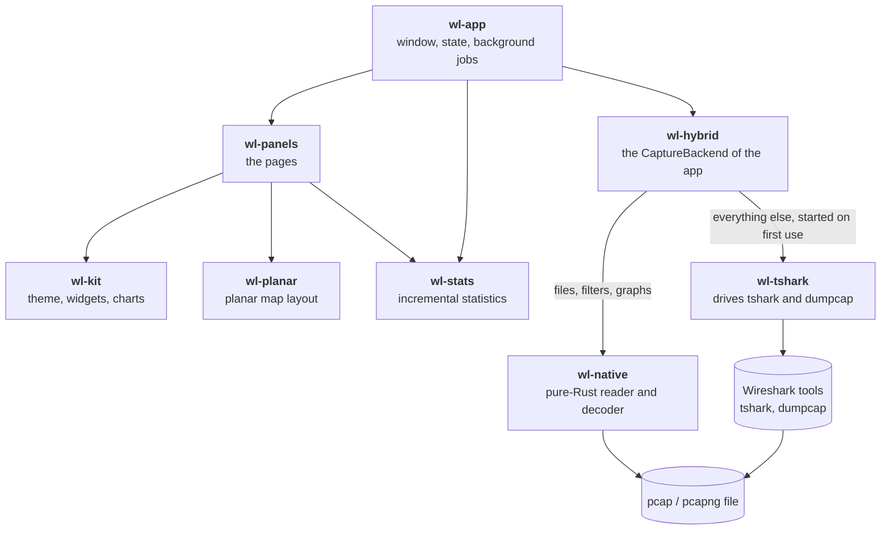

Every other crate also depends on `wl-model`, which holds the plain data types and the `CaptureBackend`
trait that `wl-tshark` and `wl-hybrid` implement. The arrows show the main flow, not every dependency.

| Crate | Role |
| --- | --- |
| `wl-model` | Plain data types and the `CaptureBackend` trait. No I/O. |
| `wl-native` | Pure-Rust capture file reader, packet decoder, display-filter subset, I/O series and file properties. |
| `wl-hybrid` | The `CaptureBackend` the app uses: answers from `wl-native` when it can and starts `wl-tshark` on first need. |
| `wl-tshark` | `CaptureBackend` implementation on top of `tshark`, `dumpcap` and friends. |
| `wl-stats` | Incremental statistics over the packet stream. |
| `wl-planar` | Planarity test and straight-line planar drawing, used by the Planar layout of the map. No dependency on the other crates. |
| `wl-kit` | Theme, widgets and charts shared by the UI. |
| `wl-panels` | The pages (packets, overview, map, flows, web, settings, ...). |
| `wl-app` | The `pilotfish` binary: window, state, background jobs. |

`tests/fixtures/` holds the small capture files the tests read, `assets/screenshots/` the README
images, and `assets/logo/` the logo (the SVG source, PNG, `.ico` and `.icns`
exports, and the GitHub social preview image).

## Tests

```sh
cargo test --workspace
```

Tests that need `tshark` or loopback capture rights skip themselves when those are missing. The
native reader, decoder, filters, rows, I/O series, file properties and frame detail are each
compared with tshark on every fixture capture; see [docs/native-backend.md](docs/native-backend.md).

## Benchmark

The native reader against tshark on the same file, measured by a small program in this repository.
It generates a deterministic synthetic capture (TCP, UDP, DNS and ICMP over 50 000 conversations
and 5 000 hosts), reads it through each backend the way the app does, drops the rows as they
arrive, and reports time, rows per second and peak resident memory. Linux only (it reads
`/proc`); `tshark` has to be installed for the second command.

```sh
cargo build --release -p wl-hybrid --features test-util --example measure
M=target/release/examples/measure

$M gen /tmp/big.pcap 3000000     # 1257 MiB, written in about 2 s
$M native /tmp/big.pcap
$M tshark /tmp/big.pcap
$M native /tmp/big.pcap --keep   # also keeps every row, as the packet table does
$M tshark /tmp/big.pcap --keep
```

Use `1000000` instead of `3000000` for a run of about a minute. Results on one machine, release
build, tshark 4.7.4, one run each:

| Packets | Backend | Seconds | Rows per second | Peak memory |
| ---: | --- | ---: | ---: | ---: |
| 3 000 000 | native | 3.3 | 915 000 | 15 MiB |
| 3 000 000 | tshark | 66.8 | 45 000 | 2059 MiB |
| 1 000 000 | native | 3.3 | 300 000 | 15 MiB |
| 1 000 000 | tshark | 22.0 | 45 000 | 889 MiB |

Memory is the process's own peak for native and the `tshark` child's peak for tshark. Absolute
times depend on the disk, the CPU and what else is running; the shape does not: native memory
stays flat while tshark's grows with the file. With `--keep`, both paths cost about 235 to 246
bytes per row in the app, because the rows are the same type, so the native path saves tshark's
share and not the packet table's. The numbers are for a synthetic capture; real traffic with
other protocol mixes can differ. `crates/wl-native/tests/memory_flat.rs` keeps the flat-memory
property under test.

## Known limits

- Everything depends on the installed Wireshark version; field names follow `tshark` 4.x.
- Reading a file natively keeps memory flat (15 MiB for 3 million packets, against about 2 GiB for
  `tshark` on the same file, see [docs/native-backend.md](docs/native-backend.md)), but the
  packet table still holds one row per packet in the app, about 235 bytes each, and anything that
  needs `tshark` (deep dissection, streams, HTTP and TLS details) pays its memory cost on large files.
- The native decoder labels the common protocols (ARP, ICMP, TCP, UDP, DNS, TLS, HTTP, DHCP, NTP,
  mDNS, SSDP, QUIC) and shows other application protocols as TCP or UDP. It does not mark
  retransmissions or number fragmented datagrams like Wireshark. Times in file properties are local by default, and UTC can be chosen in Settings.
- Native display filters cover addresses, ports, stream and frame numbers, TCP flags, TTL and the
  protocol names above; any other filter is evaluated by `tshark`.
- Name suggestions in the filter (DNS log, SNI, HTTP Host) appear once the background scan of an
  opened file has finished, and only for the names the capture itself contains; there is no
  reverse lookup.
- The findings in Insights are heuristics with thresholds you can tune in Settings > Insights (by default 20
  ports for a scan, 8 connections for a steady rhythm); expect false positives from polling and keep-alives.
- Threat lists are matched offline from files you provide; they match exact addresses and domains (and their parent
  domains), not address ranges. Credential detection only sees cleartext protocols.
- HTTP/2 and QUIC handling is best effort. Chunked bodies without a `Content-Length` are
  only partly accounted for.
- The Streams tab shows the first line of each payload; protobuf messages are not decoded, and
  WebSocket messages compressed with `permessage-deflate` depend on what `tshark` can inflate.
- Only one comment per packet is read from a capture, and saved comments are written on one line.
- A key log is not remembered between runs; start the app with `SSLKEYLOGFILE` set to keep using one.
- Windows and macOS have not been tried.

## Contributing

See [CONTRIBUTING.md](CONTRIBUTING.md). Security problems: see [SECURITY.md](SECURITY.md).

## License

GPL-3.0-or-later, see `LICENSE`.
