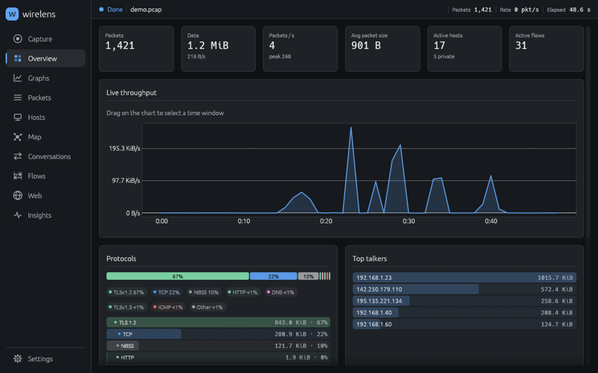
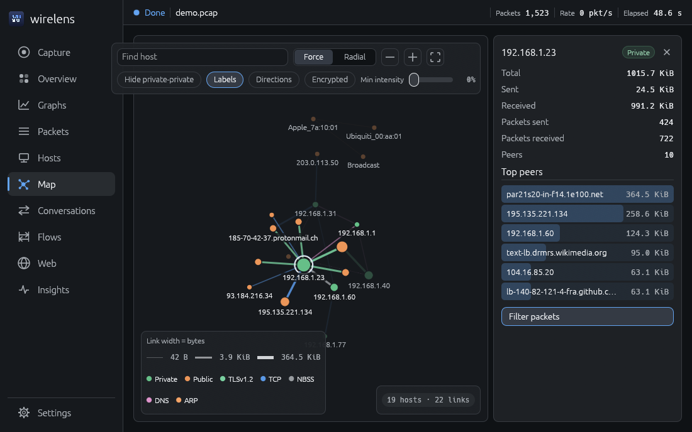
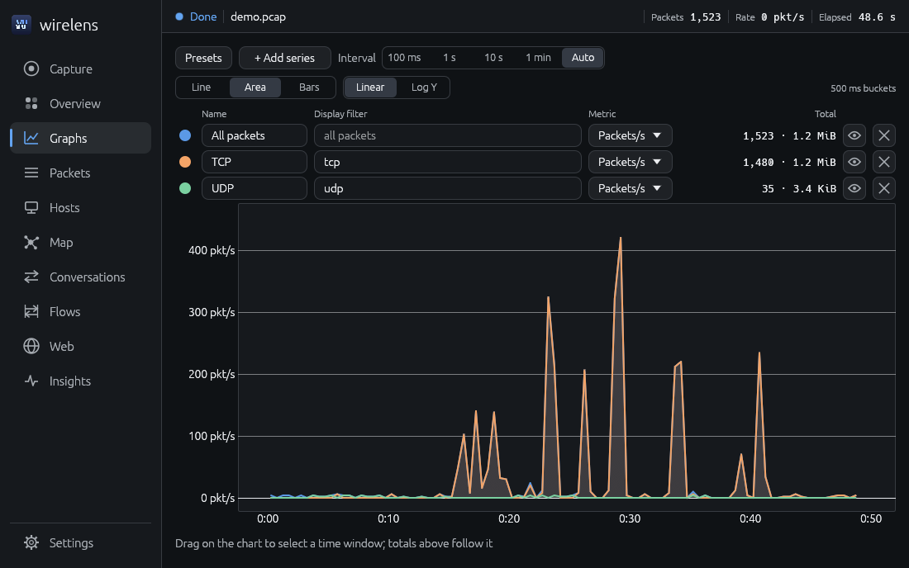
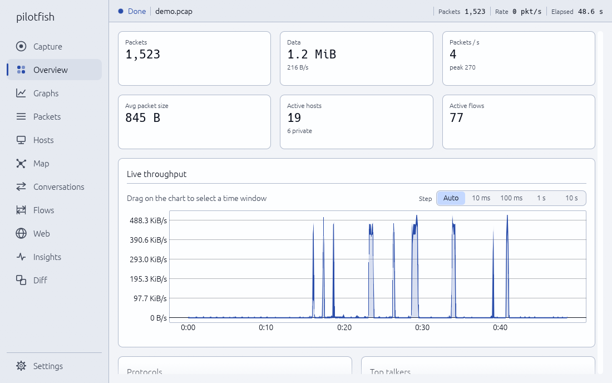
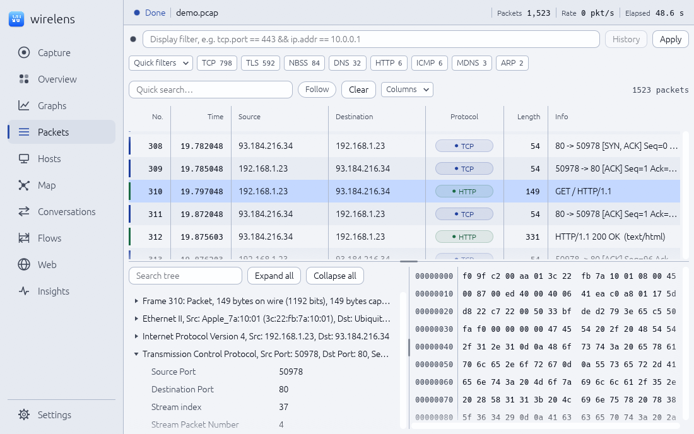
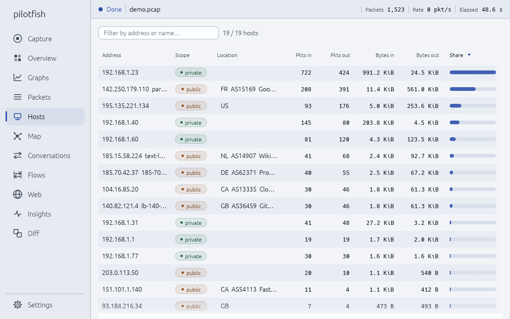
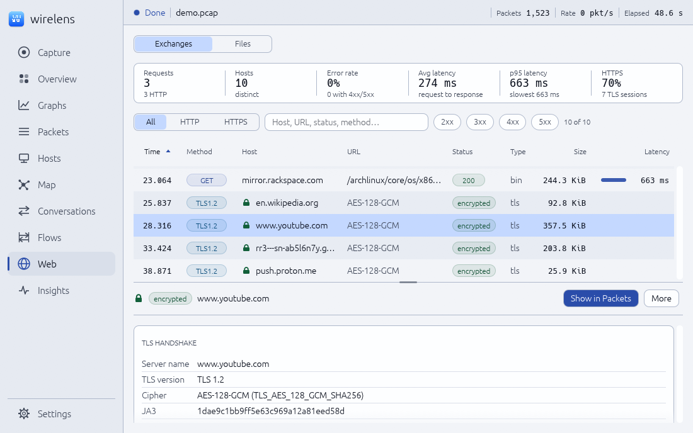
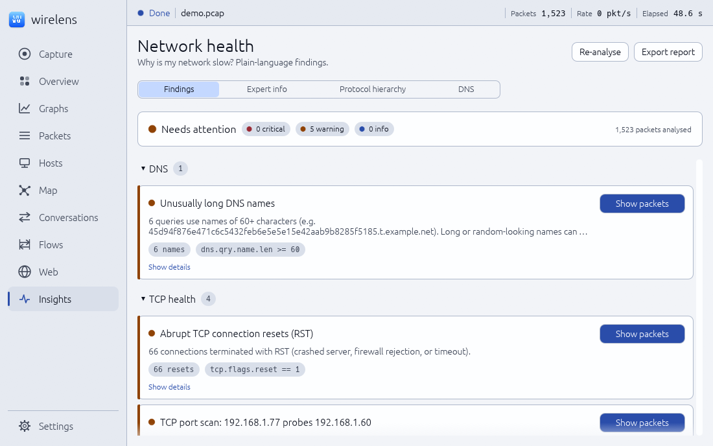
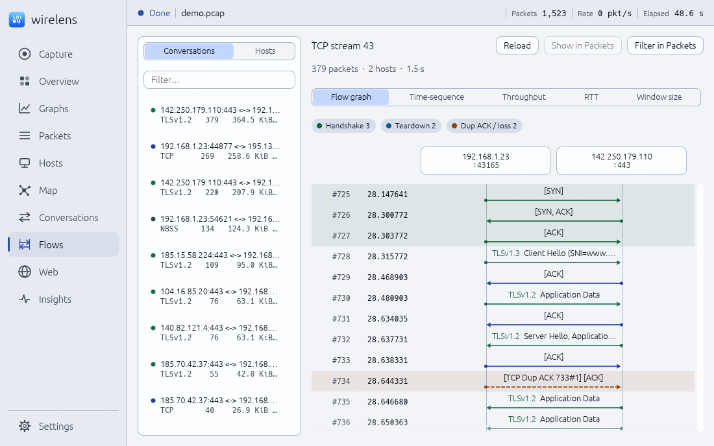
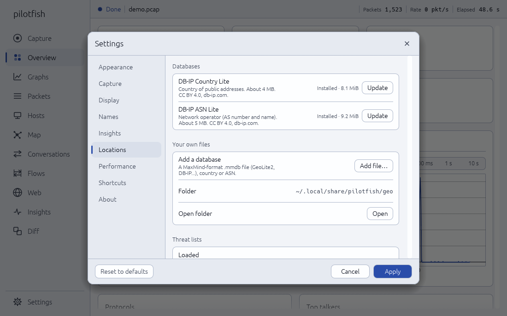

<p align="center">
  <picture>
    <source media="(prefers-color-scheme: dark)" srcset="assets/logo/wirelens-dark.svg">
    
  </picture>
</p>

<h1 align="center">wirelens</h1>

[](https://github.com/anyhowfeel/wirelens/actions/workflows/ci.yml)
[](LICENSE)
[](https://www.rust-lang.org)


A small desktop packet viewer written in Rust with [egui](https://github.com/emilk/egui).
It does no dissection of its own: captures are read and filtered by `tshark` / `dumpcap`
(Wireshark's command-line tools), and wirelens turns the output into tables, charts and a
host graph.

This is a prototype built to explore what a Wireshark front end could look like. It is not
meant to replace Wireshark or Sniffnet, and it covers only a small part of what they do.

## Screenshots

Taken on a small synthetic capture: a laptop, a TV, a phone and a NAS on an invented home network,
talking to well-known public services over DNS, TLS, plain HTTP and SMB-style transfers, with a
retransmission burst and three made-up behaviours for Insights (a visitor scanning the NAS, a phone
calling a documentation address at a steady rhythm, and very long DNS names). Nothing in it comes from a
real network. `tests/fixtures/demo.pcap` is the same network without those three behaviours, so you can
open it and compare most pages: `wirelens tests/fixtures/demo.pcap`.

| Overview | Packets | Hosts |
| :---: | :---: | :---: |
|  |  |  |

| Map | Web | Insights |
| :---: | :---: | :---: |
|  |  |  |

| Flows | Graphs | Settings |
| :---: | :---: | :---: |
|  |  |  |

<details>
<summary>Light theme</summary>

| Overview | Packets | Hosts |
| :---: | :---: | :---: |
|  |  |  |

| Map | Web | Insights |
| :---: | :---: | :---: |
|  |  |  |

| Flows | Graphs | Settings |
| :---: | :---: | :---: |
|  |  |  |

</details>

## Install

Each [release](https://github.com/anyhowfeel/wirelens/releases) contains, next to a `SHA256SUMS` file:

| Platform | File | Notes |
| --- | --- | --- |
| Debian, Ubuntu | `wirelens_<version>_amd64.deb` / `_arm64.deb` | `sudo apt install ./wirelens_*.deb` pulls in `tshark`. |
| Arch Linux | `wirelens-<version>-1-x86_64.pkg.tar.zst`, or `packaging/arch/PKGBUILD` | `sudo pacman -U wirelens-*.pkg.tar.zst` (the package is not signed), or `cd packaging/arch && makepkg -si` to build it from the tagged source. |
| Other Linux | `wirelens-<tag>-linux-x86_64.tar.gz`, `-linux-aarch64.tar.gz` | Unpack and run `./wirelens`. |
| Windows | `wirelens-<version>-windows-x86_64-setup.exe` | Installer; a `.zip` with the bare executable is also provided. |
| macOS | `wirelens-<version>-macos-arm64.dmg`, `-macos-x86_64.dmg` | Drag `wirelens` to `Applications`. The app is not signed: on first launch use right-click, Open. |

Wireshark's command-line tools (`tshark`, `dumpcap`) must be installed separately on Windows and
macOS. These packages are built by CI and have not been tested on every platform.

## Requirements

- A recent stable Rust toolchain (edition 2024).
- Wireshark's command-line tools on `PATH`: `tshark`, `dumpcap`, and optionally `editcap`,
  `mergecap` and `capinfos` (export, large selections and file properties use them).
- For live capture, permission to capture without root (on Linux, being in the `wireshark`
  group is usually enough).

Developed and tested on Linux only (Wayland and X11).

## Build and run

```sh
cargo run --release -- capture.pcapng      # open a file
cargo run --release -- --live eth0         # capture live on an interface
cargo run --release                        # start on the Capture page
```

The binary is called `wirelens`.

## Command line

```
wirelens [OPTIONS] [FILE]
```

| Option | Description |
| --- | --- |
| `FILE` | Capture file (`.pcap`, `.pcapng`, `.pcap.gz`) to open. |
| `--live <IFACE>` | Start a live capture on this interface. |
| `--filter <EXPR>` | Display filter applied to the opened file, as if typed in the filter bar. |
| `--page <NAME>` | Page to open: `capture`, `overview`, `graphs`, `packets`, `hosts`, `map`, `conversations`, `flows`, `web`, `insights`. |
| `--detach <PAGE>` | Open a page in its own window (repeatable). |
| `--decode-as <RULE>` | Decode-as rule applied at startup, e.g. `tcp.port==8080,http` (repeatable). |
| `--scale <F>` | UI scale factor, e.g. `1.25`. |
| `--size <WxH>` | Initial window size, e.g. `1440x900`. |
| `--light` | Start in the light theme. |
| `-h`, `--help` / `-V`, `--version` | Help and version. |

A few hidden options exist for development (`--screenshot`, `--bench-frames`, `--demo-map`,
...); they are not part of the supported interface.

Environment variables:

| Variable | Description |
| --- | --- |
| `SSLKEYLOGFILE` | TLS key log passed to `tshark`, so HTTPS traffic can be decrypted. |
| `WIRELENS_CONFIG_DIR` | Directory for the preferences file (defaults to the user config directory). |
| `WIRELENS_GEO_DIR` | Extra folder searched for location databases (`.mmdb`). |

## What it does

- **Capture**: interface list grouped by type with live rates, capture options (filter,
  promiscuous, snap length, ring buffer, auto-stop), recent files.
- **Packets**: virtualized packet list that stays responsive with about a million rows, display
  filter bar with field completion (and, after an operator, the hosts and ports of the capture)
  plus quick-filter chips, find (string, regex, hex),
  dissection tree with click-to-filter, hex view, custom columns, time formats, bookmarks,
  stream following, export (pcap subsets, CSV, JSON, HTML report).
- **Overview, Hosts, Conversations**: totals, throughput, protocol mix, top talkers, with an
  optional time-window selection (to the millisecond) on the throughput chart. Hosts show the
  country and network of public addresses when a local `.mmdb` database is present (see below).
- **Graphs**: I/O graph with several display-filter series.
- **Map**: force-directed graph of host-to-host traffic, link width by volume, optional highlight
  of encrypted flows.
- **Flows**: sequence diagram of a conversation, plus TCP time-sequence, throughput, RTT and
  window-size graphs.
- **Web**: HTTP requests paired with responses (headers, pretty or raw JSON, readable HTML,
  image preview, `curl` export) and TLS sessions (SNI, version, cipher, ALPN, JA3 / JA4 fingerprints) for HTTPS;
  extracted objects.
- **Insights**: plain-language findings (including port scans, sweeps, beaconing and odd DNS
  names), expert info, protocol hierarchy, DNS log.
- **Diff**: compares the open capture with a second one (`--diff FILE` or the Choose capture
  button): new, missing and changed hosts, services, mean latencies, HTTP hosts, status codes and
  TLS server names.
- Command palette (`Ctrl+K`), settings (`Ctrl+,`), dark and light themes.

Shift+click on a sidebar entry opens that page in a separate window.

### Country and network of hosts

Open Settings > Locations to download the free DB-IP Country and ASN databases (about 4 and 5 MB),
or to add your own MaxMind-format `.mmdb` files (GeoLite2, DB-IP Lite). They are kept in
`~/.local/share/wirelens/geo`; wirelens also reads the qBittorrent `GeoDB` folder, `/usr/share/GeoIP`
and the folder named by `WIRELENS_GEO_DIR`. Lookups are offline. The only thing wirelens downloads is
the file you ask for with the Download button.

The country and network shown in the screenshots come from the DB-IP Lite databases, licensed
[CC BY 4.0](https://creativecommons.org/licenses/by/4.0/): IP Geolocation by [DB-IP](https://db-ip.com).

## Releases

Tagging `vX.Y.Z` makes the CI build and publish binaries for Linux (x86_64 and aarch64, plus
a build made on Arch Linux), macOS (Apple silicon and Intel) and Windows (x86_64), together
with a `.deb` package for each Linux architecture, a Windows installer, macOS disk images and
a `SHA256SUMS` file. Those builds are not tested beyond compiling; `tshark` still has to be
installed separately on Windows and macOS.

## Layout of the repository

| Crate | Role |
| --- | --- |
| `wl-model` | Plain data types and the `CaptureBackend` trait. No I/O. |
| `wl-tshark` | `CaptureBackend` implementation on top of `tshark`, `dumpcap` and friends. |
| `wl-stats` | Incremental statistics over the packet stream. |
| `wl-kit` | Theme, widgets and charts shared by the UI. |
| `wl-panels` | The pages (packets, overview, map, flows, web, settings, ...). |
| `wl-app` | The `wirelens` binary: window, state, background jobs. |

`tests/fixtures/` holds the small capture files the tests read, `assets/screenshots/` the README
images, and `assets/logo/` the logo (SVG sources in a blue and a dark version, PNG, `.ico` and
`.icns` exports, and the GitHub social preview image).

## Tests

```sh
cargo test --workspace
```

Tests that need `tshark` or loopback capture rights skip themselves when those are missing.

## Known limits

- Everything depends on the installed Wireshark version; field names follow `tshark` 4.x.
- Files over a few hundred thousand packets load quickly but `tshark` itself uses a lot of
  memory on them.
- Name suggestions in the filter (DNS log, SNI, HTTP Host) appear once the background scan of an
  opened file has finished, and only for the names the capture itself contains; there is no
  reverse lookup.
- The findings in Insights are heuristics with fixed thresholds (for example 20 ports for a scan, 8
  connections for a steady rhythm); expect false positives from polling and keep-alives.
- HTTP/2 and QUIC handling is best effort. Chunked bodies without a `Content-Length` are
  only partly accounted for.
- Windows and macOS have not been tried.

## Contributing

See [CONTRIBUTING.md](CONTRIBUTING.md). Security problems: see [SECURITY.md](SECURITY.md).

## License

GPL-3.0-or-later, see `LICENSE`.
